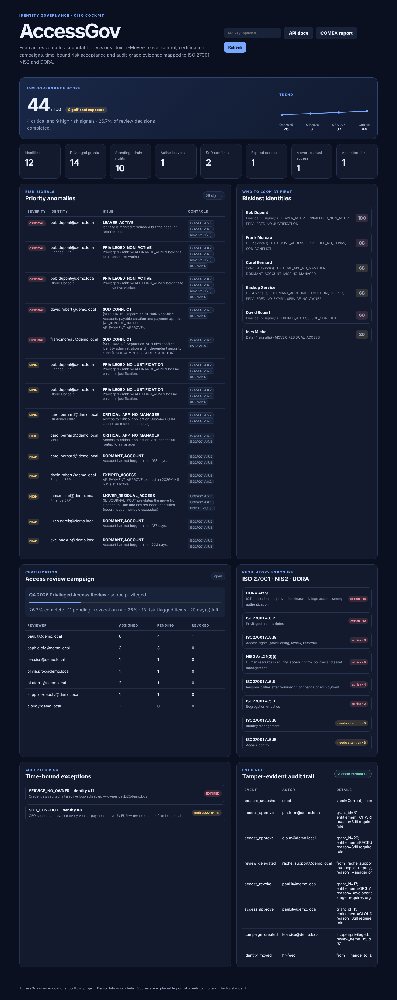

# AccessGov

**Identity governance platform built from a CISO perspective: Joiner-Mover-Leaver control, IAM risk signals mapped to ISO 27001 / NIS2 / DORA, certification campaigns, time-bound risk acceptance, tamper-evident audit evidence and executive reporting.**

Instead of asking only:

> Who has access to which application?

AccessGov asks:

> Does this person still need the access, is it risky, who must decide, which regulation is at stake — and can we prove the decision two years later?



## What's new in v2.0

| Capability | v1 | v2 |
|---|---|---|
| Risk signals | 9 | **13** (+ expired access, standing admin rights, mover residual access, expired exception) |
| Separation of duties | hard-coded | **Policy-as-code** rules (CRUD, enable/disable, severity) |
| Joiner-Mover-Leaver | detection only | **Offboarding workflow, mover workflow, HR-feed reconciliation** |
| Time-bound access | — | Expiry dates, expiring-soon view, automatic expiry sweep |
| Risk acceptance | — | **Time-bound exceptions** with owner, compensating control and guardrails |
| Compliance | — | Every signal mapped to **ISO 27001:2022, NIS2 Art. 21, DORA Art. 9** + coverage view |
| Access reviews | approve / revoke | + delegation, bulk decisions, self-certification blocked, mandatory revocation reason, reminders, metrics, overdue tracking |
| Audit evidence | event log | **SHA-256 hash-chained** log + verification endpoint + signed CSV evidence export |
| Security | open API | **API-key RBAC** (admin / reviewer / auditor), security headers |
| Reporting | dashboard | + **COMEX report**, posture snapshots and trend, riskiest identities ranking |
| Tests | 8 | **31** |

## IAM risk signals

| Signal | Severity | Example | Main references |
|---|---|---|---|
| `LEAVER_ACTIVE` | Critical | Terminated employee still enabled | ISO A.5.18, A.6.5 · NIS2 21(2)(i) |
| `PRIVILEGED_NON_ACTIVE` | Critical | Admin right held by a leaver | ISO A.8.2, A.6.5 · DORA Art.9 |
| `SOD_CONFLICT` | Rule-defined | Create invoice + approve payment | ISO A.5.3 · DORA Art.9 |
| `SERVICE_NO_OWNER` | High | Service account without accountable owner | ISO A.5.9, A.5.16 |
| `DORMANT_ACCOUNT` | High | No login for 90+ days | ISO A.5.16, A.5.18 |
| `PRIVILEGED_NO_JUSTIFICATION` | High | Admin right without business reason | ISO A.8.2, A.5.15 |
| `CRITICAL_APP_NO_MANAGER` | High | Critical-app access with no approver | ISO A.5.2, A.5.18 |
| `EXPIRED_ACCESS` | High | Time-bound access past its end date | ISO A.5.18, A.8.2 |
| `MOVER_RESIDUAL_ACCESS` | Medium → High | Pre-move access not recertified (High after 30 days) | ISO A.5.18, A.6.5 |
| `EXCEPTION_EXPIRED` | High | Accepted risk past its expiry | ISO 6.1.3 · NIS2 21(2)(f) |
| `MISSING_MANAGER` | Medium | Human identity with no manager | ISO A.5.2, A.5.16 |
| `EXCESSIVE_ACCESS` | Medium | Too many entitlements | ISO A.5.15 · DORA Art.9 |
| `PRIVILEGED_NO_EXPIRY` | Medium | Standing admin right (no just-in-time) | ISO A.8.2 · DORA Art.9 |

Mappings are indicative: they show how a technical signal supports a compliance obligation, not a legal opinion.

## Governance guardrails

- **Prevent at the door, detect the legacy**: the API rejects privileged grants without justification and grants to terminated identities; imported legacy data is detected instead.
- **Accepted risk stays temporary**: exceptions require a justification, a compensating control and a risk owner, cannot exceed 180 days, cannot be self-approved, and **leaver risks can never be accepted**. When an exception expires, the original signal resurfaces together with `EXCEPTION_EXPIRED`.
- **Segregation of duties in the review process itself**: nobody can certify their own access, delegate a review to the identity under review, or revoke without a reason. Bulk decisions are all-or-nothing.

## Architecture

```text
HR extract / CSV / API
        │
        ▼
FastAPI ──► RBAC (X-API-Key: admin | reviewer | auditor) + security headers
        │
        ├── Inventory: identities, applications, grants (time-bound)
        ├── Lifecycle: offboard, move, HR sync, expiry sweep
        ├── Risk engine: 13 signals + SoD policy-as-code + exceptions
        ├── Compliance mapping: ISO 27001 / NIS2 / DORA
        ├── Campaigns: routing, delegation, bulk, metrics, reminders, evidence
        ├── Reporting: summary, trend snapshots, top identities, COMEX report
        └── Audit: SHA-256 hash chain + verification
        │
        ▼
SQLite (local) / PostgreSQL (Docker)
```

## Quick start

```bash
python3 -m venv .venv && source .venv/bin/activate     # Windows: py -m venv .venv ; .\.venv\Scripts\Activate.ps1
pip install -r requirements.txt
python scripts/seed_demo.py
uvicorn app.main:app --reload
```

- Dashboard: `http://127.0.0.1:8000`
- OpenAPI: `http://127.0.0.1:8000/docs`
- COMEX report: `http://127.0.0.1:8000/api/v1/reports/executive`

The synthetic demo dataset is rebased on the current date and deliberately imperfect: an active leaver, SoD conflicts, an expired temporary access, a mover with residual Finance rights, an accepted SoD risk, an expired exception, a partially completed privileged-access campaign with a delegation, and a posture history.

### Docker

```bash
docker compose up --build
docker compose exec api python scripts/seed_demo.py
```

## Security model

| Role | Can |
|---|---|
| `admin` | Everything: inventory, imports, HR sync, lifecycle, SoD rules, exceptions, campaigns |
| `reviewer` | Read + review decisions, bulk decisions, delegation |
| `auditor` | Read + audit trail, chain verification, evidence export |

Configure `API_KEYS="key1:admin,key2:reviewer,key3:auditor"`. When empty, the API runs in **demo mode** (every caller is admin) and `/health` reports `"auth_mode": "demo"`.

## API tour

```bash
# Posture, compliance, riskiest identities, trend
curl localhost:8000/api/v1/dashboard/summary
curl localhost:8000/api/v1/dashboard/compliance
curl localhost:8000/api/v1/dashboard/top-identities
curl -X POST "localhost:8000/api/v1/dashboard/snapshots?label=Q4"
curl localhost:8000/api/v1/dashboard/trend

# Risk signals (include accepted ones with include_excepted=true)
curl "localhost:8000/api/v1/anomalies?severity=CRITICAL"

# Joiner-Mover-Leaver
curl -X POST localhost:8000/api/v1/identities/2/offboard -H "Content-Type: application/json" -d '{"reason":"Resignation"}'
curl -X POST localhost:8000/api/v1/identities/9/move -H "Content-Type: application/json" -d '{"department":"Sales"}'
curl -X POST localhost:8000/api/v1/imports/hr-sync -F "file=@data/hr_feed.csv"
curl -X POST localhost:8000/api/v1/grants/expire-sweep
curl "localhost:8000/api/v1/grants/expiring?days=14"
curl localhost:8000/api/v1/identities/4/profile

# SoD policy-as-code
curl -X POST localhost:8000/api/v1/sod-rules -H "Content-Type: application/json" \
  -d '{"code":"SOD-OPS-02","left_entitlement":"CLOUD_ADMIN","right_entitlement":"SECURITY_AUDITOR","severity":"HIGH"}'

# Time-bound risk acceptance
curl -X POST localhost:8000/api/v1/exceptions -H "Content-Type: application/json" -d '{
  "anomaly_code":"SOD_CONFLICT","identity_id":4,
  "justification":"Single accountant during month-end close",
  "compensating_control":"CFO reviews every payment above 5k EUR",
  "risk_owner":"cfo@demo.local","approved_by":"cfo@demo.local","expires_at":"2027-02-01T00:00:00Z"}'

# Access review campaign
curl -X POST localhost:8000/api/v1/campaigns -H "Content-Type: application/json" \
  -d '{"name":"Q1 Critical Apps","scope":"critical_apps","created_by":"ciso@demo.local"}'
curl localhost:8000/api/v1/campaigns/1/metrics
curl localhost:8000/api/v1/campaigns/1/reminders
curl -X POST localhost:8000/api/v1/campaigns/items/3/delegate -H "Content-Type: application/json" \
  -d '{"delegate_to":"deputy@demo.local","actor":"manager@demo.local","reason":"Holiday"}'
curl -X POST localhost:8000/api/v1/campaigns/items/bulk-decision -H "Content-Type: application/json" \
  -d '{"item_ids":[5,6],"decision":"approve","reviewer_email":"paul.it@demo.local","reason":"Role unchanged"}'
curl -OJ localhost:8000/api/v1/campaigns/1/evidence      # CSV + X-Evidence-SHA256 header

# Evidence integrity and executive report
curl localhost:8000/api/v1/audit/verify
curl localhost:8000/api/v1/reports/executive
```

Campaign scopes: `all`, `privileged`, `high_risk`, `critical_apps`. Reviewer routing: manager → service-account owner → application owner → campaign owner, never the identity itself.

## Scores

- **IAM Governance Score (0-100)**: 100 minus 6 / 3 / 1 points per distinct critical / high / medium signal per identity.
- **Identity risk score (0-100)**: weighted sum of distinct signals (40 / 20 / 8 / 3), capped.

Both are explainable portfolio metrics, not industry standards.

## Run tests

```bash
python -m pytest -q      # 31 passed
```

## Production limitations

Educational implementation. Production use would require SSO/OIDC instead of API keys, database migrations (Alembic), WORM storage or external anchoring of the audit chain, real connectors (SCIM, Entra ID, Okta, HRIS), a scheduler for sweeps and reminders, rate limiting and tenant isolation. Never load real employee data into a public demo.

## Roadmap

SCIM 2.0 ingestion · Entra ID / Okta connectors · access request workflow · role mining · peer-group outlier detection · e-mail notifications · PDF evidence pack.

## Interview talking point

> I modelled IAM as a governance process, not a provisioning problem. AccessGov detects access risk, links each signal to the ISO 27001, NIS2 or DORA obligation it threatens, routes decisions to accountable people with segregation-of-duties guardrails, keeps accepted risk time-bound and produces evidence an auditor can verify — plus a COMEX report that turns all of it into decisions to arbitrate.

## License

MIT — see `LICENSE`.
